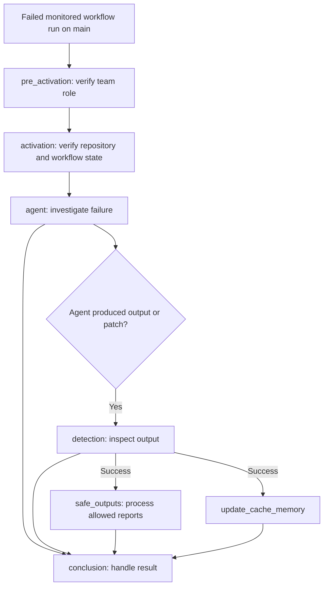

# CI Failure Doctor

This generated workflow investigates failures from selected main-branch CI workflows and can report findings through configured safe outputs.

## At a glance

| | |
| --- | --- |
| Platform | GitHub Actions |
| Source | [`ci-doctor.lock.yml`](../ci-doctor.lock.yml) and authoring config [`ci-doctor.md`](../ci-doctor.md) |
| Trigger | Failed completed runs of `e2e`, `Validate Policies`, or `Publish Policies` on `main` |

## Purpose

The checked-in workflow instructions define an automated CI failure investigator. It gathers workflow and job details, examines failure logs and patterns, and prepares findings and recommendations. The generated workflow also gates investigation on repository and team membership checks and limits write operations to its configured reporting outputs.

## When it runs

The workflow listens for completed runs of `e2e`, `Validate Policies`, and `Publish Policies` on `main`. It proceeds only when the conclusion is `failure`. The generated definition further requires that the source run belongs to this repository, is not from a fork, and passes a team membership check for a user with `admin`, `maintainer`, or `write` access.

There are no path filters or schedule.

## Execution flow

| Job | Runs when | Depends on | What it does |
| --- | --- | --- | --- |
| `pre_activation` | The workflow run failed | None declared | Checks that the triggering user has an allowed repository role and emits the activation result. |
| `activation` | Activation succeeded, the run failed, and the source is the same non-fork repository | `pre_activation` | Checks workflow file timestamps before starting the agent. |
| `agent` | Activation succeeds | `activation` | Runs the configured failure-investigation agent. Produces agent output and supporting artifacts, including logs and cache-memory data. |
| `detection` | Agent output contains output types or a patch | `agent` | Runs threat detection on agent output and uploads its detection log. |
| `safe_outputs` | The agent was not skipped, the run was not cancelled, and detection succeeded | `agent`, `detection` | Processes the configured issue-creation and comment outputs. The source limits issue and comment output counts. |
| `update_cache_memory` | Detection succeeded | `agent`, `detection` | Saves the investigation memory cache. |
| `conclusion` | The agent was not skipped; runs with `always()` | `activation`, `agent`, `detection`, `safe_outputs`, `update_cache_memory` | Handles agent failures, missing tools, and no-op messages and prepares the final workflow outcome. |

## Inputs, outputs, and access

| Item | Details |
| --- | --- |
| Inputs | The triggering workflow-run metadata; investigation uses configured web-fetch and cache-memory tools. |
| Outputs | Artifacts include `safe-output`, `agent-output`, `agent_outputs`, `agent-artifacts`, and `cache-memory`; the detection job can also upload `threat-detection.log`. Cache-memory is restored and saved as a cache. Safe outputs may create one issue with the configured `automation` and `ci` labels and add a comment. |
| Permissions | The authoring file declares `read-all`; the generated workflow has empty top-level permissions and job-level permissions. The `agent` job has `read-all`; reporting jobs receive issue, discussion, and pull-request write permissions where configured. |
| Secrets | `COPILOT_GITHUB_TOKEN`, `GH_AW_GITHUB_MCP_SERVER_TOKEN`, `GH_AW_GITHUB_TOKEN`, and `GITHUB_TOKEN` are referenced by name in the generated workflow. |

## Operational notes

`ci-doctor.lock.yml` is generated output. The authoring file's upstream source metadata points to content whose monitored workflow names differ from the checked-in authoring file and lock; this page documents the local configuration shown in those files. The configured reporting behavior is limited to the safe outputs in the authoring source; the workflow also stores memory data in an artifact/cache for later investigations. The local files do not verify the current remote runtime settings.

## Sources

- Generated workflow: [`ci-doctor.lock.yml`](../ci-doctor.lock.yml)
- Authoring instructions and configuration: [`ci-doctor.md`](../ci-doctor.md)
