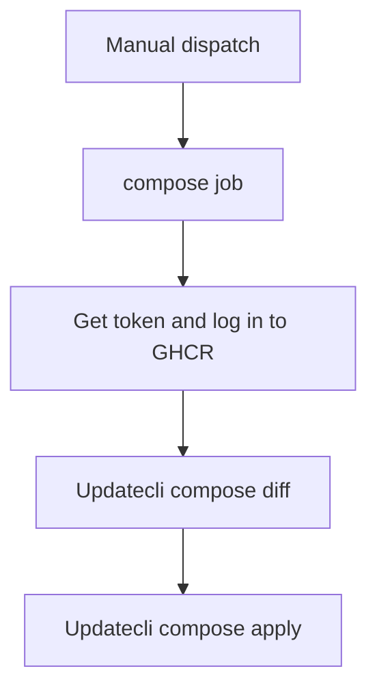

# e2e

Manually compares and applies the repository's composed Updatecli policy updates.

## At a glance

| | |
| --- | --- |
| Platform | GitHub Actions |
| Source | [`e2e.yml`](../e2e.yml) |
| Trigger | Manual dispatch |

## Purpose

This workflow exercises the repository's compose configuration by first calculating policy diffs and then applying the configured updates. The composed policies and test inputs are defined in [`updatecli-compose.yaml`](../../../updatecli-compose.yaml).

## When it runs

The workflow runs only when manually dispatched. It has no dispatch inputs, branch filters, or schedule.

## Execution flow

| Job or step | Runs when | Depends on | What it does |
| --- | --- | --- | --- |
| `compose` job | Manual dispatch | None declared | Runs on `ubuntu-latest`, obtains a GitHub token, and authenticates to GHCR. |
| Compose diff | After setup and registry login | Earlier steps in `compose` | Runs Updatecli's experimental compose diff command using the pinned version. |
| Compose apply | After the diff step succeeds | Compose diff | Runs Updatecli's experimental compose apply command using the same compose configuration. |

## Inputs, outputs, and access

| Item | Details |
| --- | --- |
| Inputs | No workflow inputs are declared. |
| Outputs | No workflow outputs, artifacts, or caches are declared. |
| Permissions | Workflow: `contents: read`. Job: `contents: write`, `id-token: write`, `packages: read`, and `pull-requests: write`. |
| Secrets | `GITHUB_TOKEN` is used for registry login. A generated token is passed to both Updatecli commands as `GITHUB_TOKEN`; token values are not stored in this documentation. |

## Operational notes

The diff and apply commands run sequentially in one job. This workflow applies the composed configuration; it is distinct from the `make e2e-test` diffs in [`Validate Policies`](validate.md).

## Sources

- Workflow: [`e2e.yml`](../e2e.yml)
- Compose manifest and test values: [`updatecli-compose.yaml`](../../../updatecli-compose.yaml)
- Pinned Updatecli version: [`.tool-versions`](../../../.tool-versions)
