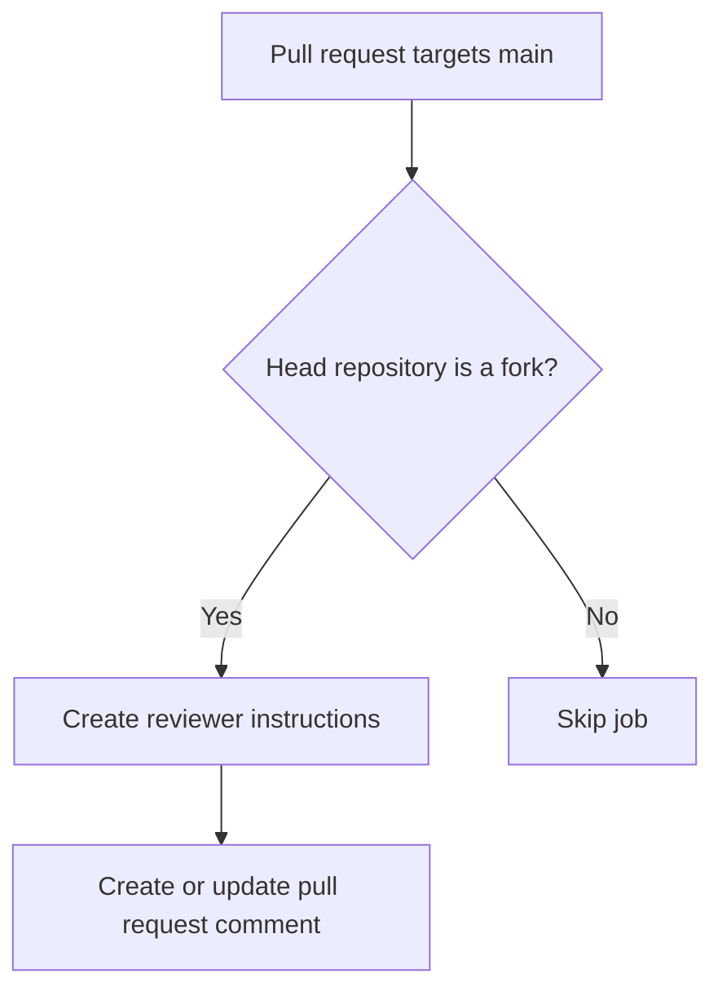

# forked-pull-requests

Posts reviewer instructions to pull requests from forks without checking out or running their code.

## At a glance

| | |
| --- | --- |
| Platform | GitHub Actions |
| Source | [`forked-pull-requests.yaml`](../forked-pull-requests.yaml) |
| Trigger | Pull requests targeting `main`; the job runs only for fork-originated pull requests |

## Purpose

Fork pull requests do not run the credential-bearing end-to-end tests in the validation workflow. This workflow leaves reviewers instructions for running those tests locally instead.

## When it runs

The workflow uses `pull_request_target` for pull requests targeting `main`. Its single job is conditional on the pull request head repository being a fork. There are no path filters or schedule.

## Execution flow

| Job or step | Runs when | Depends on | What it does |
| --- | --- | --- | --- |
| `validate` | Head repository is a fork | None declared | Builds an instructions file with a local end-to-end test command, then creates or updates the matching pull request comment. It does not check out or execute pull request code. |

## Inputs, outputs, and access

| Item | Details |
| --- | --- |
| Inputs | Uses the pull request number from the triggering event. |
| Outputs | No workflow outputs, artifacts, or caches are declared. |
| Permissions | Workflow: `contents: read`. Job: `issues: write` and `pull-requests: write`. |
| Secrets | Uses the workflow-provided GitHub token to create or update the comment; no secret values are documented. |

## Operational notes

The job writes the reviewer instructions to `instructions.txt` and replaces the existing matching comment rather than adding a duplicate. The suggested local command uses the caller's authenticated token and directs the workspace outside the checkout.

## Sources

- Workflow: [`forked-pull-requests.yaml`](../forked-pull-requests.yaml)
