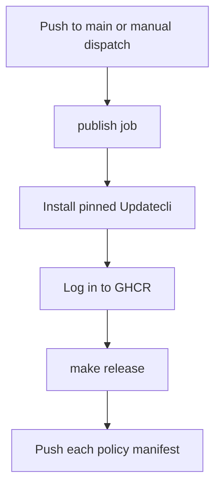

# Publish Policies

Publishes each policy bundle to the repository's GHCR namespace.

## At a glance

| | |
| --- | --- |
| Platform | GitHub Actions |
| Source | [`release.yaml`](../release.yaml) |
| Trigger | Pushes to `main` and manual dispatch |

## Purpose

The repository distributes reusable Updatecli policy bundles through GHCR. This workflow publishes the bundle manifests after changes reach `main` or when manually dispatched.

## When it runs

- On pushes to `main`.
- On manual dispatch.

There are no path filters or schedule.

## Execution flow

| Job or step | Runs when | Depends on | What it does |
| --- | --- | --- | --- |
| `publish` | Every supported event | None declared | Runs on `ubuntu-latest`, installs Updatecli, authenticates to GHCR, and runs `make release`. |

## Inputs, outputs, and access

| Item | Details |
| --- | --- |
| Inputs | No workflow inputs are declared. |
| Outputs | Publishes policy manifests to `ghcr.io/elastic/oblt-updatecli-policies`; no workflow outputs or artifacts are declared. |
| Permissions | Workflow: `contents: read`. Job: `contents: read` and `packages: write`. |
| Secrets | `GITHUB_TOKEN` is used for GHCR login; its value is not included here. |

## Operational notes

`make release` invokes the repository's release script in publish mode. The script discovers policy manifests under `updatecli/policies` and pushes them to matching GHCR paths. The Updatecli version comes from [`.tool-versions`](../../../.tool-versions).

## Sources

- Workflow: [`release.yaml`](../release.yaml)
- Make target: [`Makefile`](../../../Makefile)
- Publish implementation: [`release.bash`](../../../.ci/scripts/release.bash)
- Pinned Updatecli version: [`.tool-versions`](../../../.tool-versions)
