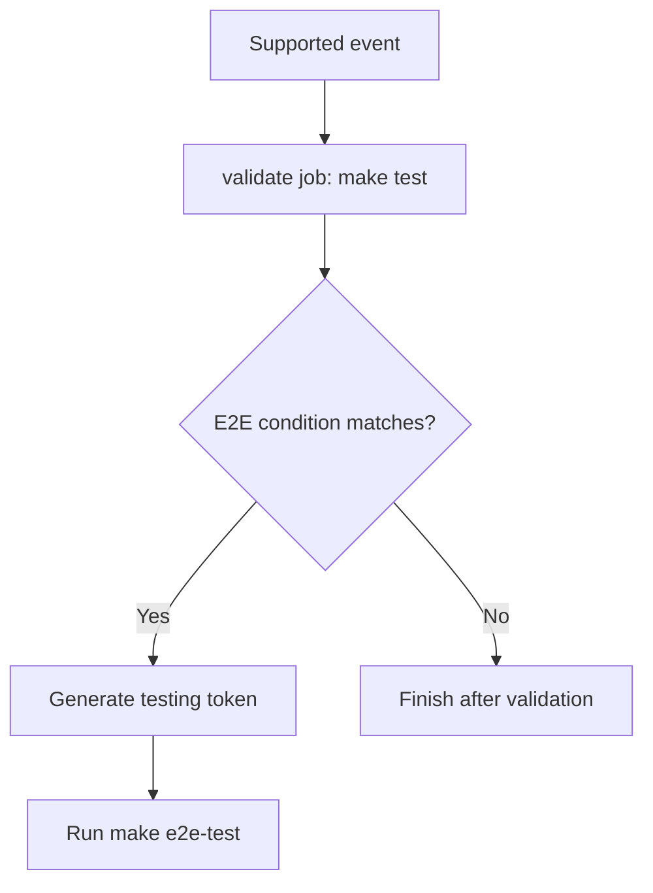

# Validate Policies

Validates policy bundle metadata on every supported CI trigger and runs credentialed end-to-end policy diffs only under the configured conditions.

## At a glance

| | |
| --- | --- |
| Platform | GitHub Actions |
| Source | [`validate.yaml`](../validate.yaml) |
| Trigger | `merge_group`, pull requests targeting `main`, pushes to `main`, and manual dispatch |

## Purpose

This workflow checks that the repository's policy bundles contain the required files and current metadata. It can also run end-to-end Updatecli diffs; those steps use a generated GitHub App token and are gated to avoid running credential-bearing checks on fork pull requests.

## When it runs

- For merge queue events.
- For pull requests targeting `main`.
- For pushes to `main`.
- On manual dispatch. The `run-e2e-tests` boolean input defaults to `false`.

There are no path filters or schedule. The end-to-end token-generation and diff steps run only when the ref is `main`, when a manual dispatch explicitly enables `run-e2e-tests`, or when the pull request comes from the same repository. Fork pull requests still run the metadata validation.

## Execution flow

| Job or step | Runs when | Depends on | What it does |
| --- | --- | --- | --- |
| `validate` job | Every supported event | None declared | Runs on `ubuntu-latest`; validates required policy files and metadata with `make test`. |
| `Get token from GitHub App` and `e2e tests` | Main ref, opted-in manual dispatch, or same-repository pull request | Earlier steps in `validate` | Creates a testing token, then runs `make e2e-test` to diff each policy using its test values. Both steps use the same condition. |

## Inputs, outputs, and access

| Item | Details |
| --- | --- |
| Inputs | Manual dispatch accepts `run-e2e-tests` (boolean, default `false`). |
| Outputs | No workflow outputs, artifacts, or caches are declared. |
| Permissions | Workflow: `contents: read`. Job: `contents: read` and `id-token: write`. |
| Secrets | The generated testing token is passed to the end-to-end command as `GITHUB_TOKEN`; the workflow does not expose its value in configuration. |

## Operational notes

`make test` checks each discovered policy's required files, metadata URLs, version, and latest changelog entry. The end-to-end command performs policy diffs; a validation or diff failure fails the job. Fork pull requests skip the token and end-to-end steps.

## Sources

- Workflow: [`validate.yaml`](../validate.yaml)
- Make targets: [`Makefile`](../../../Makefile)
- Validation and diff implementation: [`release.bash`](../../../.ci/scripts/release.bash)
- Pinned Updatecli version: [`.tool-versions`](../../../.tool-versions)
